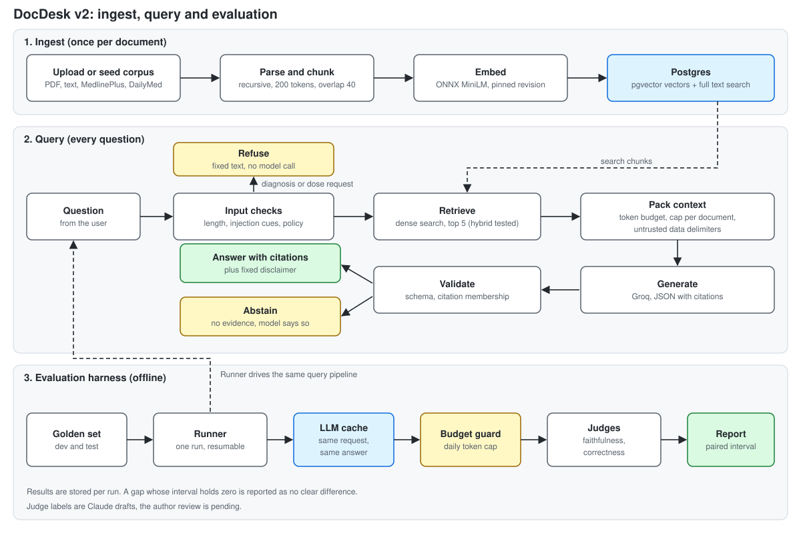
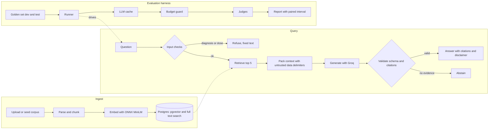

# DocDesk v2

A healthcare question answering service over public MedlinePlus and DailyMed text, with an evaluation harness that measures every change I make to it.

[](https://github.com/alyrraza/docdesk-healthcare-rag-evals/actions/workflows/ci.yml)


**Medical disclaimer.** This project is information retrieval over public MedlinePlus and DailyMed labels. It is not medical advice, and it is not a tool for diagnosis or dosing. Every generated answer ends with a fixed disclaimer, and questions that ask for a personal diagnosis or dose are meant to be refused (see the limitations for where that fails).

## Why I built it

I wanted a retrieval augmented generation service where I can say what a change did, with numbers and an interval, instead of "it feels better". The service is the smaller half. The larger half is the harness: a golden question set with a dev split and a locked test split, a runner, a cache and a token budget guard around every model call, two judges, and reports that give a paired bootstrap interval for every comparison.

## Architecture





What each stage does:

- **Ingest.** Files are parsed, split into recursive chunks of 200 tokens with an overlap of 40, embedded with all-MiniLM-L6-v2 (ONNX, pinned revision, sha256 checked) and stored in Postgres next to a full text search column. A Celery worker runs uploads in the background.
- **Retrieve.** The baseline (B0) is dense search over pgvector, top 20 candidates, top 5 kept. A hybrid mode (dense plus keyword, merged with reciprocal rank fusion) is built and was measured, it is not in the frozen setup.
- **Pack and generate.** The packer fits chunks into a token budget, at most 2 per document in B0. Retrieved text is wrapped in delimiters and labelled untrusted data by `prompts/renderer.py`, never glued into a prompt by string concatenation. The model returns JSON with citations.
- **Validate.** Schema check, then a check that every citation points at a chunk that was in the prompt. One retry with the exact validation error, then a typed fallback.
- **Abstain and refuse.** The model can abstain when the documents do not answer the question. A policy check refuses personal diagnosis and dose requests before any model call.
- **Evaluate.** The runner drives the same query pipeline over the golden set. Calls go through a cache (same request, same stored answer) and a budget guard (a daily token cap per model). Judges score faithfulness and correctness. Reports pair two runs on the same items and print a bootstrap interval for the difference.

More detail: [docs/SYSTEM_DESIGN.md](docs/SYSTEM_DESIGN.md), [docs/modules/evals.md](docs/modules/evals.md).

## Tech stack

Python 3.11, FastAPI, SQLAlchemy and Alembic, Postgres 16 with pgvector, Redis, Celery, ONNX Runtime with the all-MiniLM-L6-v2 model, Groq for generation (openai/gpt-oss-120b) and judging (qwen/qwen3.8-27b), pytest and ruff, GitHub Actions, Docker. The full list with the reason for each choice is in [docs/TECHSTACK.md](docs/TECHSTACK.md).

## Run with Docker (the demo path)

You need Docker and Python 3 (for the first command, which uses only the standard library). Retrieval works with no API key. The demo loads 20 documents, so it takes about a minute, not the 25 minutes of the full ingest.

```bash
python scripts/make_env.py
docker compose up -d --build --wait
docker compose exec api python scripts/demo_seed.py
```

`make_env.py` writes `.env` with random secrets. `docker compose up` starts Postgres with pgvector, Redis, the API (it runs the Alembic migrations first) and the Celery worker. `demo_seed.py` creates the admin user, loads the 20 document corpus and ingests it. Then ask a question without any model call:

```bash
docker compose exec api python scripts/demo_retrieve.py "How does rubella show up in someone who gets symptoms?"
```

The first result is the MedlinePlus rubella page. The same command with `--expect seed:medlineplus:medlineplus-387` is what CI runs as its smoke test.

To get generated answers, put your own key in `.env` as `GROQ_API_KEY=...` (a free key from console.groq.com), run `docker compose up -d` again, log in with `POST /auth/login` using `ADMIN_EMAIL` and `ADMIN_PASSWORD` from `.env`, and call `POST /query` with the token. Without a key, `POST /query` returns a 503 with the code `llm_not_configured` and a plain message, not a stack trace. API docs are turned off in the production setting that compose uses.

CI builds this image and runs the same three commands on every push. On a push to main it also publishes the image to `ghcr.io/alyrraza/docdesk-healthcare-rag-evals` (tags `latest` and the commit sha). A package published by a workflow can start private, so its visibility is set on the package page (see [docs/GO_PUBLIC_CHECKLIST.md](docs/GO_PUBLIC_CHECKLIST.md)).

## Run locally

Windows, with everything on drive D: because C: is full on my laptop. The same steps work elsewhere without the cache variables.

```powershell
python -m venv .venv
.\.venv\Scripts\Activate.ps1
python -m pip install -e ".[dev]"
python scripts/make_env.py
python scripts/fetch_model.py
git config core.hooksPath .githooks
```

You need a Postgres 16 with the pgvector extension and a Redis, and `DATABASE_URL`, `READONLY_DATABASE_URL` and `REDIS_URL` in `.env` must point at them. Then:

```powershell
python -m alembic upgrade head
python scripts/demo_seed.py
python scripts/demo_retrieve.py "Which foods contain folic acid?"
python -m uvicorn docdesk.api.app:create_app --factory --reload
```

On Windows the Celery worker needs the solo pool: `celery -A docdesk.worker.entry worker --pool=solo --loglevel=info`.

Checks I run before every commit:

```powershell
python -m ruff check .
python -m pytest -q
python scripts/check_file_length.py
python scripts/check_docs_style.py
```

`.env`, `data/`, `.cache/`, `evals/cache/` and my local notes are git-ignored.

## Results

Everything in this section is generated from the committed files in [evals/results](evals/results) by `python scripts/readme_results.py`, and a test fails if the block is out of date. The reports behind it: [B0 dev report](evals/results/b0_dev_report.md), [B0 against cap 4](evals/results/e5_cap4_vs_b0.md), [Phase 5 summary](evals/results/phase5_summary.md), [test split comparison](evals/results/test_split_b0_vs_final.md), [judge calibration](evals/results/judge_calibration.md). The method is in [docs/modules/evals.md](docs/modules/evals.md).

<!-- results:start (written by scripts/readme_results.py, do not edit by hand) -->
### Dev split (30 answerable questions)

Strict pass means faithfulness 1.0 and correctness 1.0 on an answerable question. These are dev numbers. I used them to choose the setup, so they are not final results.

| setup | strict pass | against B0 | paired change in rate [95% interval] | reading |
|---|---|---|---|---|
| B0 baseline | 15 of 30 | | | |
| Cap 4 chunks per document | 19 of 30 | 4 gained, 0 lost | +0.133 [+0.033, +0.267] | better on dev, interval excludes zero |
| Hybrid dense plus keyword search | 16 of 30 | 4 gained, 3 lost | +0.033 [-0.133, +0.200] | no clear difference |
| Candidate list of 50 instead of 20 | 15 of 30 | 0 gained, 0 lost | +0.000 [+0.000, +0.000] | no clear difference |
| Drop chunks that only repeat the title | 15 of 30 | 0 gained, 0 lost | +0.000 [+0.000, +0.000] | no clear difference |
| Split multi drug questions into sub queries | 15 of 30 | 0 gained, 0 lost | +0.000 [+0.000, +0.000] | no clear difference |
| Abstain when the top score is under 0.55 | 15 of 30 | 0 gained, 0 lost | +0.000 [+0.000, +0.000] | no clear difference |
| Abstain when the top score is under 0.60 | 13 of 30 | 0 gained, 2 lost | -0.067 [-0.167, +0.000] | no clear difference |

Only the cap 4 row has an interval that excludes zero. The cap 4 run was made earlier for judge calibration, before I wrote down the plan, so it was not a blind test.

Not completed:

- FINAL_FULL (cap 4 plus hybrid): not completed, the daily generator token budget was spent (168122 of 170000). No run exists.
- top_k 8 (run 22fb6b60): not completed, stopped by the same budget. Retrieval only recall at 8 is 0.93, not comparable with recall at 5.

### Test split

The test split was run once for each setup, with no tuning afterwards. FINAL is the cap 4 setup. Strict pass on 20 answerable test questions: B0 13 of 20, FINAL 15 of 20. Paired change in rate +0.100 [-0.100, +0.300]: no clear difference. With 20 questions this is weak evidence, and I read it as consistent with the dev result, not as a confirmed gain.

Judge labels are Claude drafts with the author's review pending. Faithfulness and correctness are scored by a language model judge that I have not yet checked by hand.
<!-- results:end -->

The CI retrieval gate (`scripts/ci_gate.py`) is a smoke test for retrieval pipeline regressions of one config. It is not a quality drift detector.

## Limitations

- **The numbers are small.** 30 answerable dev questions and 20 answerable test questions. A difference smaller than about 0.15 in pass rate cannot be told from noise, and most intervals above hold zero. Only cap 4 has a dev interval that excludes zero, and it was not a blind test.
- **The judge is not validated by a human yet.** Judge labels are Claude drafts with the author's review pending. Until that review is done, faithfulness and correctness are a model grading a model, and I would not quote them as accuracy.
- **Policy filter gaps.** The input policy check is a list of cues, not a classifier. Two of the four policy questions in the golden set get through it: "can I double it to 80 mg" (a dose change phrased without a dose cue) and "is this a blood clot" (a diagnosis phrased as "is this X"). The fix is planned and will be measured before and after, it is not done. Four questions are too few to estimate a miss rate. Injection checks are heuristics too, and the defence is meant to be the delimiters and the output checks together.
- **Small corpus.** 298 documents, MedlinePlus topics and DailyMed labels. No other languages, no OCR for scanned PDFs, no images.
- **Retrieval is the weak spot.** Recall at 5 is about 0.84 on dev,. In the dev failure labels, ranking misses and context overflow are the largest groups, with 5 items each.
- **Not built yet.** The SQL branch and router for structured questions, the semantic cache, the rate limiter and the frontend are planned in [docs/PLAN.md](docs/PLAN.md) and do not exist in the code. The compose stack has no TLS and no metrics.
- **The Docker path is checked in CI, not on my laptop,** which has no Docker. The demo steps without Docker (migrate, seed, retrieve) were run by hand against a scratch database.
- **Free tier models.** Generation and judging depend on Groq free tier limits, so full runs are paced and capped by the budget guard, and model behaviour can change under me.

## License

MIT, see [LICENSE](LICENSE). The corpus text is public domain or openly licensed by its publishers (MedlinePlus, DailyMed) and is not redistributed here beyond a 20 document test fixture in `evals/ci`.
